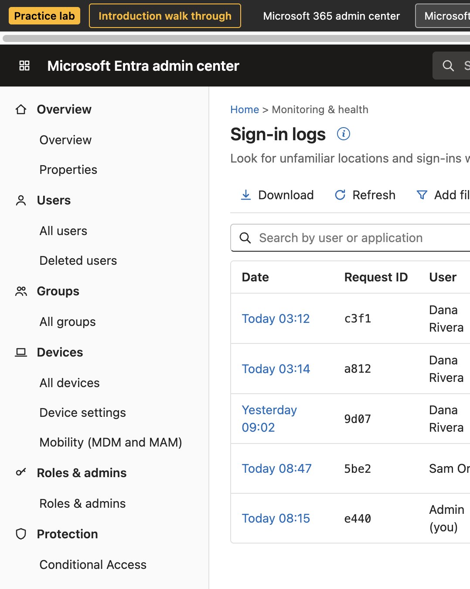

# Admin Practice Lab

Practice real Microsoft 365 and hybrid-identity admin work with nothing to break. A browser-based simulator of Windows Server Active Directory, the Microsoft 365 admin center, Entra ID, Intune, Exchange, and a virtual Windows laptop, all linked together. No tenant, no sign-up, no install.

Simulates hybrid identity: Active Directory, Entra Connect sync, Group Policy, hybrid join, and real help-desk scenarios.

**Try it now:** https://markplowwright.github.io/admin-practice-lab/



> This is a learning simulator. It does not connect to Microsoft, and all users, passwords, and domains in it are fake. Nothing you do here touches a real tenant.

## Why I built this

When I was learning Microsoft 365 admin work, I kept having to use YouTube to figure out how to do things. I wanted somewhere I could just practice, so I built this to help myself. Then I realized that if I had this trouble, a lot of other people must have it too, so I made it free for anyone who is learning the same things.

## Who it's for

People who want to learn IT admin tasks before they have access to a real tenant: help desk and IT support beginners, career changers, and admins coming from Jamf or Google Admin who are learning Entra ID and Intune.

## How it works

The first time you open it, a welcome page and a 3-minute tour explain the six places you'll work and how missions work (or skip straight to Level 1). You can reopen the introduction at any time with the **Introduction walk through** button in the gray bar at the top. Then you follow a five-level path in the **Lab guide**:

| Level | What you practice |
|---|---|
| 1. Onboarding | Prepare Intune for new laptops, onboard a new hire (usage location, license, groups, Autopilot laptop), license by group |
| 2. Offboarding | Block sign-in, revoke sessions, hand off OneDrive files, reclaim the license and laptop, apply least privilege |
| 3. Compromised accounts and MFA | Contain a compromised account (password, sessions, rogue phone number, mail forwarding), roll out MFA with Conditional Access |
| 4. Intune and laptops | BitLocker disk encryption vs compliance, app deployment, Autopilot setup and enrollment errors, joining a laptop by hand and checking `dsregcmd /status` |
| 5. Hybrid identity | Active Directory users and groups, OU sync scope, Entra Connect, Group Policy, domain and hybrid join, and help-desk scenarios |

There are 18 guided missions with 64 guided steps, plus 10 real-world scenarios. Every guided step names the portal and menu path and has a **Go there** button. A step is checked off when you actually do it in the lab, and when you finish a mission the guide explains **why it works that way**.

## Hybrid identity

The Active Directory workspace includes AD Users and Computers, Group Policy Management, and a Microsoft Entra Connect Sync panel. Practice creating and disabling users in `practice.local`, managing security-group membership, moving objects between OUs, resetting computer accounts, applying GPOs, and synchronizing selected OUs to Entra.

Synced users clearly show Windows Server AD as their source of authority. Licensing and cloud-session controls remain in Microsoft 365 and Entra. The virtual laptop supports local domain join, hybrid registration, `dsregcmd /status`, `gpupdate /force`, `gpresult /r`, and trust-relationship repair.

Directory sync uses a deterministic lab clock. The displayed 30-minute directory cycle and roughly 2-minute password-hash cycle are common defaults, not fixed Microsoft guarantees. Soft-delete restoration and license recovery are intentionally simplified teaching approximations.

## Real-world scenarios

Level 5 includes ten ticket-style exercises covering lockouts, source-of-authority password resets, onboarding, urgent offboarding, missing file-share access, GPO scope, broken domain trust, excluded sync OUs, expiring contractor access, and suspicious sign-ins. Hints are optional, completion checks actual state, and each completed scenario includes a cause, user-facing response, and example ticket note.

Only one scenario runs at a time in an isolated sandbox. Resetting or leaving it preserves the main lab and previously earned completion badges.

## Coming from Jamf or Google Admin?

Click the **i** icons for plain-English definitions with Jamf and Google Admin equivalents, open the **Jamf / Google** tab in the guide for a concept-by-concept translation, and read the short comparison at the end of each completed mission. The mappings are approximate because each product splits the work differently.

## Realistic failures

Enrollment can fail the way it does in a real tenant: a blocked account, a user outside the MDM user scope, a missing license (error 80180018), or device join disabled (error 801c0003). A joined but unmanaged device is fixed by correcting the scope or license and then syncing.

## Run it locally

No build step. Open `index.html` in a browser, or serve the folder:

```bash
python3 -m http.server 8000
```

The checks behind licenses, enrollment, and mission steps live in `js/rules.js`. From the project folder:

```bash
node --test tests/rules.test.js
```

Progress is saved in your browser's `localStorage`, so it stays on that browser and device. Use **Reset lab** in the guide to start over, or the **Introduction walk through** button to see the intro again.

## Deploy to GitHub Pages

Settings > Pages > Source: **Deploy from a branch** > Branch: `main`, folder `/ (root)`.

## Known limitations

- It is a simulator. Layouts approximate the real portals, which change often, so confirm steps in Microsoft's current documentation before acting on a production tenant.
- Progress is stored only in your browser. Clearing site data resets it.
- Not every real setting exists here. The lab covers the common admin tasks above, not the full product surface.
- Not affiliated with or endorsed by Microsoft, Jamf, or Google.

## Project layout

| File | Purpose |
|---|---|
| `index.html` | Page shell. Loads the styles and scripts below. No build step. |
| `css/app.css` | Layout and portal styles |
| `js/state.js` | Saved cloud tenant, on-premises AD, ids, users, groups, devices, and licenses |
| `js/rules.js` | Enrollment, AD synchronization, hybrid join, Group Policy, and mission rules. No page markup. |
| `js/ui.js` | Shared buttons, tables, wizards, and glossary |
| `js/ad.js` | AD Users and Computers, Group Policy Management, and Entra Connect Sync |
| `js/entra.js`, `js/m365.js`, `js/exchange.js`, `js/intune.js` | The four cloud admin centers |
| `js/vm.js` | Virtual Windows laptop |
| `js/guide.js` | Lab guide, welcome page, and tour |
| `js/render.js` | Drawing the page and handling clicks |
| `tests/rules.test.js` | Checks for ids, licenses, enrollment, and mission steps |
| `LICENSE` | MIT |

## Disclaimer

Not affiliated with or endorsed by Microsoft. Portal layouts are approximations for practice, and real portals change often. Always confirm steps in Microsoft's current documentation before acting on a production tenant.
